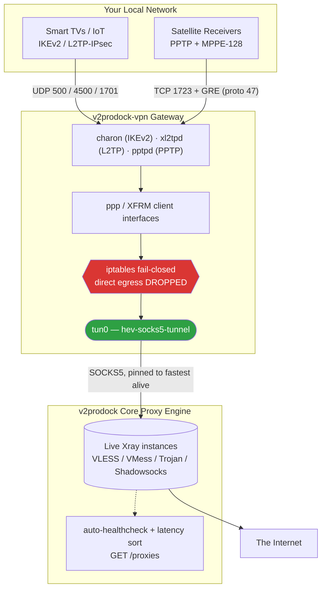

# V2ProDock

<p align="center">
  
</p>

<p align="center">
  
  
  
  
</p>

A Dockerized V2Ray/Xray proxy client that manages the entire proxy lifecycle — from subscription parsing to automatic failover. Feed it a subscription URL, and it handles the rest: parses protocols, health-checks servers, and provides stable SOCKS5 + HTTP proxies for your other apps and containers.

> [!CAUTION]
> **Disclaimer**: V2ProDock operates no proxy servers and provides no bandwidth of its own. You supply the subscription URL(s) — self-hosted or public — and the app routes your traffic through those third-party servers as a free alternative to paid proxies. Public configs are run by strangers, so treat exit nodes as untrusted: prefer TLS end-to-end, and expect no uptime, speed, or anonymity guarantees.
> 
> Failover changes your exit IP whenever the active upstream switches, and the VPN gateway is **experimental (alpha)** — do not use it in production or for anything sensitive to IP changes (IP-locked accounts, banking, anti-fraud systems). You are responsible for complying with your ISP's terms and the terms of every service you access through this project.

- [Features](#features) · [Quick Start](#quick-start) · [Multi-Instance Setup](#multi-instance-setup) · [Usage](#usage) · [VPN for legacy devices](#vpn-for-legacy-devices) · [Commands](#commands) · [How It Works](#how-it-works) · [Supported Protocols](#supported-protocols) · [Configuration](#configuration) · [License](#license)

## How it fits together



Pushed DNS is resolved through the same tunnel — clients cannot leak around the working proxy.

## Features

- **Subscription-based** — paste a v2ray subscription URL, it parses vless/vmess/trojan/shadowsocks configs automatically
- **Multi-instance** — run N independent xray processes, each with its own proxy pair and failover
- **Auto-failover** — health-checks every 60s (3-strike rule); dead servers are replaced quickly by bounded switching that can't stall the engine
- **Auto-refresh** — re-fetches subscription every 120s for updated server lists
- **Slow-proxy rotation** — sluggish connections are automatically moved to faster servers when fresh configs arrive; healthy fast ones are never touched
- **HTTP API** — query live proxies sorted by latency at `GET /proxies`
- **Dynamic ports** — all ports are auto-assigned, no hardcoded ranges
- **Docker bridge** — other containers connect through the Docker network without port mapping
- **Multi-platform** — auto-detects OS/arch and downloads the right xray-core binary
- **Low-end friendly** — tunable memory limits, connection caps, and GC tuning for constrained devices

## Quick Start

```bash
curl -fsSL https://raw.githubusercontent.com/411A/V2ProDock/main/install.sh | bash
```

Or clone manually:

```bash
git clone https://github.com/411A/V2ProDock.git && cd V2ProDock
[ -f .env ] || cp .env.example .env
# Edit .env with your subscription URL(s)
sudo bash install.sh
```

## Multi-Instance Setup

Run multiple independent proxy instances in a single container:

```bash
# .env
SUBSCRIPTION_URLS=https://sub1.example,https://sub2.example,https://sub3.example
PORT_COUNT=3
```

Port layout: all SOCKS5 ports come first, then all HTTP ports. Instance `i` of `N` gets `SOCKS5=PORT_BASE+i` and `HTTP=PORT_BASE+N+i` (e.g. with `N=3`: SOCKS `27019-27021`, HTTP `27022-27024`). `PROXY_INSTANCES` is the legacy alias for `PORT_COUNT`. Query them via the API:

```bash
# Returns alive proxies sorted by measured quality
curl http://localhost:27018/proxies
```

```json
[
  {"index":1, "socks5":"0.0.0.0:27020", "http":"0.0.0.0:27023", "status":"ok", "latency_ms":85, "name":"server-1"},
  {"index":0, "socks5":"0.0.0.0:27019", "http":"0.0.0.0:27022", "status":"ok", "latency_ms":120, "name":"server-2"}
]
```

### API Endpoints

| Endpoint | Method | Description |
|----------|--------|-------------|
| `/proxies` | GET | Alive proxies: clean first (proven uploaders, then measured throughput class, then latency), then memo'd/degraded; each carries `source`, `role`, `endpoint`, `memo`, `degraded`, `throughput_kbps`, `throughput_avg_kbps`, `bulk_usable`, `upload_ok`, `upload_broken`, and `ok_streak` |
| `/all` | GET | All instances including down ones (same quality fields) |
| `/health` | GET | `{"status":"ok","instances":3,"alive":3,"starting":0,"degraded":0,"requested":3,"allocated":3,"shortfall":0,"usable_bulk":2,"bulk_measured":2,"bulk_check":true,"usable_upload":2,"upload_measured":2,"upload_inconclusive":0,"upload_check":true}` + stable `aggregate_socks`/`aggregate_http` endpoints; `shortfall_reason` when fewer healthy sources than requested ports, `fallback_only:true` when every alive proxy has a memo, `status:"degraded"` when the bulk gate measured no usable node, `bulk_check:false` when no probe URL is configured; `upload_warning` when the upload gate confirmed broken paths and no alive node is upload-capable, `upload_probe_warning` when every probe is target-rejected (unmeasured, not broken) |
| `/vpn` | GET | VPN pinning proof: upstream SOCKS + egress IP + `verified` |
| `/refresh` | POST | Force subscription re-fetch |
| `/memo` | POST | Attach or clear a quality note for an upstream endpoint (`{"endpoint":"host:port","memo":"..."}`); it stays alive but ranks after every clean node |
| `/check` | POST/GET | Per-URL reachability: which proxies can actually reach *this* destination (see below) |

#### `/check` — dynamic URL check

`HEALTH_CHECK_URL` answers one question for the whole pool: *is the tunnel
alive?* `/check` answers a different one: *can my proxies reach **this** site?*
A pool can be perfectly healthy against gstatic while every node is filtered
for a given destination — the only way to know is to ask each upstream.

```bash
# Which proxies can reach Telegram right now?
curl -s -X POST localhost:27018/check \
  -H 'Content-Type: application/json' \
  -d '{"url":"api.telegram.org"}'

# Optional: also probe N pool candidates (spawns a throwaway xray each)
curl -s -X POST localhost:27018/check \
  -H 'Content-Type: application/json' \
  -d '{"url":"https://example.com/api","depth":4}'

# GET spelling
curl -s 'localhost:27018/check?url=example.com&depth=0'
```

```json
{
  "key": "telegram.org",
  "probed_url": "https://api.telegram.org/",
  "alive": [
    {"name":"NL | node-A","endpoint":"51.158.206.12:23576","instance":0,"latency_ms":1228,"source":"alive"}
  ],
  "pool": [],
  "checked": 2, "failed": 0,
  "duration_ms": 1571, "cached": false, "truncated": false
}
```

**The key is the domain, not the string.** `example.com`,
`http://example.com`, `https://www.example.com` and
`https://www.example.co.uk/x` all resolve through the **public suffix list**,
so `www.example.co.uk` keys to `example.co.uk` and never to `co.uk` (a naive
last-two-labels split would merge unrelated sites).

**The measurement is still per exact URL.** `/bot123/getUpdates` and `/` are
different resources behind one key, so results are cached per probe URL and the
domain key is only the reported identity — claiming a path is reachable
because a sibling path answered would be an unearned verdict.

| Field | Meaning |
|---|---|
| `key` | registrable domain (eTLD+1) — the "same URL" you asked about |
| `probed_url` | what was actually fetched through the tunnel |
| `alive[]` | instances already serving, probed on their live SOCKS port (**zero** extra processes) |
| `pool[]` | pool candidates probed on throwaway ports (only when `depth > 0`) |
| `source` | `alive` = already running; `pool` = throwaway probe |
| `truncated` | the depth cap was hit before the pool was exhausted — the answer is a **sample**, not exhaustive |

Notes:
- **Read-only.** A check never changes the active proxy, never touches the
  shared probe ledger, never rebinds a serving port. A destination nothing can
  reach cannot damage the pool.
- **Depth defaults to 0** (alive instances only, ~1s, no processes). Pool
  candidates cost a throwaway xray each (~15MB), capped at 32, so a 600-config
  pool is never swept per request.
- **Cached 60s** per probe URL; concurrent identical requests share one round
  of probing. `cached:true` in the response means the answer is up to 60s old.
- **SSRF guard.** The probe dials *from the upstream*, so a request for a
  private address would scan the *upstream's* LAN or cloud metadata. Loopback,
  RFC1918, link-local, `.local`/`.internal`/`.home.arpa` and single-label hosts
  are refused with HTTP 400. Limitation, stated plainly: only the literal is
  validated — a public hostname that resolves to `169.254.169.254` at the
  upstream cannot be detected from here. **Do not expose this endpoint to
  untrusted callers.**
- A check that completes but finds nothing is HTTP **200** with an empty
  `alive[]` — that is the answer you asked for. HTTP 400 means the request
  itself was unusable (bad scheme, refused target, malformed body).

#### `/memo` — mark a usable-but-broken node

Health checks are deliberately tiny, so a node that truncates large transfers
can pass every probe. A memo records that known quality problem **without
marking the node down**: it stays in the pool as the deliberate last resort,
but ranks after every clean node and carries the warning in the API.

```bash
# Record the finding from the 10 MB + sha256 test
curl -s -X POST localhost:27018/memo \
  -H 'Content-Type: application/json' \
  -d '{"endpoint":"203.0.113.9:443","memo":"truncates >12KB; downloads and uploads fail"}'

# Clear it after the node is replaced/fixed
curl -s -X POST localhost:27018/memo \
  -H 'Content-Type: application/json' \
  -d '{"endpoint":"203.0.113.9:443","memo":""}'
```

`/proxies` then shows that entry with `"degraded":true`, its `memo`, and
`endpoint`; it appears after all clean entries. When every alive node is
degraded, `/health` returns `"fallback_only":true` plus a warning, meaning
small requests may work but large transfers probably won't.

Memos are keyed by the upstream `host:port`, not by the local instance port:
when failover switches the instance to a different node, the old memo does not
follow the port. Seed them at boot with `PROXY_MEMOS` (comma-separated
`endpoint=memo`, no commas inside a memo):

```env
PROXY_MEMOS="203.0.113.9:443=truncates >12KB; downloads/uploads fail"
```

#### Bulk throughput gate

Health probes are 204s: a node can answer in 500 ms and then carry 1 KB/s. The
gate fetches a real **4 MiB** body through each instance's SOCKS port on
promotion and every 5 minutes (two workers, skipped when a client carried bytes
in the last 5 s). It scores the **last 2 seconds**, not the average, because a
0.5–1 MiB burst followed by 2–9 KB/s has a healthy average and a dead tail.

```json
{"throughput_kbps": 7264, "throughput_avg_kbps": 31000, "bulk_usable": true}
```

`throughput_kbps` is the tail rate (kilobits/s; divide by 8 for KB/s);
`throughput_avg_kbps` is the whole-body average. A large gap is the
burst-then-throttle signature. A node is demoted to the same **last-resort**
lane as a memo after two consecutive low/partial tails (the first low sample is
re-checked on the next health tick, so demotion takes ~1–2 minutes); one good
tail promotes it immediately. A node is never marked down.

**The probe target is deliberately not a public speed-test URL.** Those are
per-IP rate-limited through the proxy (429), which must not be read as a slow
node. Set `THROUGHPUT_CHECK_URL` to an object you control (at least 4 MiB,
`%d` is replaced by the configured byte count). Empty = gate idle with one
warning. `429/403/5xx` are **inconclusive**: the probe clock advances, but no
quality state changes.

A completed real **plain-HTTP** body of at least 1 MiB and 1 second is positive
capacity evidence too: it promotes the node even when the synthetic target is
rate-limited. Slow clients never demote.

A node that proves sustained bulk capacity is **pinned for 24 hours**: if a
subscription refresh drops its endpoint, it is appended back to the pool (the
fresh definition wins if present). Pinning prefers proven uploaders; when **no**
alive node proves a POST path, the best downloader is still pinned, so a
download-only pool is not lost to churn. A health failure, a manual memo, or a
confirmed broken upload path (when a proven peer exists) removes the pin.

Ordering within the clean and degraded partitions is: proven upload path (only
while at least one node has it), measured throughput class (≥1 MB/s, ≥512 KB/s,
≥256 KB/s, ≥128 KB/s, unknown), the `AGG_MIN_STREAK` stability partition, then
latency. A node with no upload proof is still servable; if **no** alive node is
proven, upload state is ignored and the pool simply picks its best downloader.

`/health` exposes `usable_bulk` and `bulk_measured`; once at least one node
has been measured, a pool with `usable_bulk:0` reports `status:"degraded"` and
a `bulk_warning`, because small probes are not evidence of bulk capacity. The
independent upload fields are `usable_upload`, `upload_measured`,
`upload_inconclusive`, and `upload_check`, with an `upload_warning` when the
gate confirmed broken paths and no alive node can carry a POST, or an
`upload_probe_warning` when every probe was target-rejected (unmeasured, never
treated as a dead node).

Tune or disable it:

```env
THROUGHPUT_CHECK=1
THROUGHPUT_FLOOR_KBPS=800        # 800 kbps ≈ 100 KB/s
THROUGHPUT_INTERVAL_SECS=300
THROUGHPUT_CHECK_BYTES=4194304   # 4 MiB
THROUGHPUT_TIMEOUT_SECS=45
THROUGHPUT_CHECK_URL=https://your-static-host.example/probe.bin
# THROUGHPUT_CHECK=0            # metered host or blocked target
```

#### Upload-capability gate — POSTs are a separate path

A download probe cannot detect a node that accepts a CONNECT and streams a
response body but drops or stalls a request body. That failure is invisible to
`throughput_kbps`: GET succeeds at full speed while every POST fails. A small
POST through the same SOCKS port closes that blind spot.

```env
UPLOAD_CHECK=1
UPLOAD_CHECK_URL=https://your-echo-host.example/post  # accepts a body, returns 2xx
UPLOAD_CHECK_BYTES=16384        # 16 KiB, same cadence as the bulk gate
UPLOAD_CHECK_TIMEOUT_SECS=20
```

The target must accept a POST and return 2xx only after reading the body; an
echo endpoint is ideal. A target-level rejection (4xx/5xx/redirect) is
inconclusive and condemns nothing. Two consecutive conclusive failures mark the
node `upload_broken`; one success restores `upload_ok`. A broken or unmeasured
node is **never removed**: proven uploaders are ordered first only while at
least one exists, and if none does the pool chooses its best downloader. Empty
`UPLOAD_CHECK_URL` keeps the gate idle and preserves the old ordering exactly.

Pinning prefers proven uploaders: once any alive node proves a POST path, a
newly pinned node must prove it too. When none does, the best downloader is
still pinned so the pool cannot lose its only working nodes to churn.
`upload_broken` and `upload_ok` are exposed on `/proxies`; `/health` carries
`usable_upload`, `upload_measured`, `upload_inconclusive`, `upload_check`, and
the two warnings above.

Repeated short **plain-HTTP** bodies (Content-Length not satisfied) are counted
per endpoint; after 3, the node is auto-memo'd. HTTPS/CONNECT bodies are opaque
to the bridge, so those are covered by the throughput gate instead.

#### Mixed pool: subscriptions + static upstreams

Static upstreams are ordinary pool candidates, not a separate mode:

```env
PORT_COUNT=5
STATIC_UPSTREAMS="edge=socks5://gateway-host:1080,office=http://gateway-host:8080"
# legacy shortcut for one static entry:
# UPSTREAM_PROXY=socks5://gateway-host:1080
```

Each static entry becomes one config with its own source label, health checks,
throughput tail probe, upload probe, memo/degraded handling and port. Static
entries are trusted and fill the first ports; subscription configs fill the
remaining ports and stay available as replacements. When a port's proxy dies,
the selector re-points it to another working config with a **different
`host:port`**; if none exists, that port goes down and `/health` reports the
shortfall. The stable aggregate ports always route to the best alive instance,
even when only one source survives.

`PORT_COUNT` is the number of exposed instance ports; `PROXY_INSTANCES` remains
a legacy alias. Duplicate endpoints are collapsed, with a static declaration
winning over a subscription line. `UPSTREAM_PROXY` is sugar for a single static
entry and no longer disables subscriptions; if no subscription URLs are
configured, the static entries are the pool.

A malformed static entry fails startup closed. Credentials are confined to the
0600 xray config; logs, errors and `/proxies` expose `scheme://host:port` and
the source name, never the password.

#### `XRAY_MUX` — measured per-flow shaping experiment

Mux is **off by default**. `XRAY_MUX=1` adds xray `mux.cool` to VMess/VLESS/
Trojan outbounds (`XRAY_MUX_CONCURRENCY`, default 8). It can help many parallel
flows on an ISP that shapes per TCP flow, but it cannot make a single bulk
stream faster and adds head-of-line risk. XTLS Vision and any subscription-
provided `mux` are left untouched. A/B the bulk number before keeping it on.

#### Ingest hygiene — keep unusable configs out of the pool

A selector cannot rescue a pool of unusable configs. A measured public pool
contained many Reality targets with implausible SNIs and several transports
with no TLS at all; those flows were shaped to 1–5 KB/s as soon as they opened.
Filtering to configs with real public SNIs moved the same host from 2.1 KB/s to
1.15 MB/s with an identical sha256.

At fetch time the daemon always rejects **Reality with an implausible SNI**
(empty, an IP, a single-label/local name, a malformed hostname, or a name whose
public suffix is not recognized), **Reality on the operator's optional
`SNI_DENYLIST`**, and malformed outbound JSON.

With `REQUIRE_TRANSPORT_SECURITY=1` it additionally rejects **Shadowsocks** and
**VMess/VLESS without TLS/Reality**. This is opt-in: a general-purpose pool can
keep every protocol; a DPI-hardened pool trades those transports for a pool
that is less likely to be shaped.

It keeps TLS VMess/VLESS, Trojan, and Reality whose SNI is the node's own
domain or a plausible public host. An optional `SNI_DNS_CHECK=1` additionally
rejects only definite NXDOMAIN; timeouts/SERVFAIL stay inconclusive so a
filtered resolver does not drop a good node.

```env
REQUIRE_TRANSPORT_SECURITY=0   # 1 = DPI-hardened: reject SS/bare VMess/VLESS
SNI_DENYLIST=                  # optional operator entries, *.suffix supported
SNI_ALLOWLIST=                 # optional escape hatch for a new/private suffix
SNI_DNS_CHECK=0                # 1 = strict resolvability check
```

Each filtered source logs one line:

```text
subscription ...: rejected 34/100 unsafe configs (21 no TLS, 12 bad Reality SNI, 1 malformed)
```

If every config from a source is rejected, the source is marked failed for
that refresh; use a curated source with real-SNI configs. The 4 MiB tail gate
still catches a secure-looking node that is throttled after the burst.

### Stable endpoints (bots & long-polling clients)

Per-instance ports die and come back on every failover — pinning a Telegram
bot to one of them means rewriting config on each switch. Instead, point
long-lived clients at the aggregate ports (defaults `SOCKS5 :27017`,
`HTTP :27016`, inside the published range). An opt-in third aggregate,
`RELAY :27015`, routes the same way but exits via the clean-IP relay
(`CF_RELAY_URL`; see `docs/CF_RELAY_WORKER.md`) instead of the tunnel exit:

```python
# One fixed config, forever: every connection is routed to the
# fastest alive instance at dial time, no restarts needed.
proxies = {"http": "http://localhost:27016", "https": "socks5://localhost:27017"}
```

Failover behavior from the client's view: the old instance keeps serving
while replacements are probed in parallel, the swap itself is a ~1–3s
rebind, and new connections immediately land on the next healthy instance.
In-flight long-polls on a truly dead upstream still break (TCP is TCP) —
reconnect, don't restart the whole gateway. Query `GET /health` once to
discover the aggregate addresses if you customized the ports.

### When a transfer stops at ~12 KB

A proxy that completes the TLS handshake but cuts every sizable body at a
fixed size (commonly one TLS record, ~12–16 KB) is **broken, not slow**. A
`HEAD` request or the 204 used by health checks still succeeds, so the pool
keeps selecting it: probes are deliberately tiny and cannot see truncation.
Package installs, `git clone`, Docker pulls and large uploads will fail
intermittently while small API calls look fine.

First identify the port. This stack publishes **27000-27017** and
**27019-27100**; per-instance ports start at `PORT_BASE` (`27019` by
default) and aggregates are `27015-27017`. A port like `28010` is outside
that range unless you changed `PORT_BASE`/the compose mapping, so it is
normally an upstream node or a different tool. Confirm with:

```bash
docker compose config | grep -A4 'ports:'
curl -s http://127.0.0.1:27018/health
curl -s http://127.0.0.1:27018/proxies
```

Measure bytes, not status codes, and compare checksums. Test each hop
(upstream SOCKS, per-instance HTTP, aggregate) so the broken layer is
obvious:

```bash
URL='https://speed.cloudflare.com/__down?bytes=10000000'
curl -fsS --proxy http://HOST:PORT -o /tmp/proxied.bin \
     -w 'http=%{http_code} bytes=%{size_download} speed=%{speed_download}\n' "$URL"
sha256sum /tmp/proxied.bin
# Same URL with the upstream SOCKS port:
curl -fsS --socks5-hostname HOST:SOCKS_PORT -o /tmp/socks.bin "$URL"
```

If one upstream truncates, record it with `POST /memo` (or seed
`PROXY_MEMOS`): it stays alive as the deliberate last resort but ranks after
every clean node, and `/proxies` shows the warning. The bulk gate below also
catches a node that cannot carry a 4 MiB body; memos remain useful for
problems the gate cannot see (upload-only breakage, intermittent truncation).
Remove the subscription/node entirely if you do not want it used even as a
fallback. `AGG_MIN_STREAK` and the health checks cannot detect truncation on
their own, because their probes are tiny. If **all** paths truncate, check the
host's CPU quota first — see [docs/MONITORING.md](docs/MONITORING.md) — then
test with `XRAY_TCP_CONGESTION=bbr` on a lossy link. On a 10%-of-a-core plan,
sustained video/TLS crypto can exceed the guarantee and look like packet loss,
but a precise, repeatable ~12 KB ceiling is almost always a bad proxy hop, not
CPU.

Transport notes:

- **TCP** (HTTPS/HTTP, YouTube, Telegram files, git, package installs) is
  carried end-to-end by the relay. The bridge is byte-transparent and has
  multi-megabyte regression tests in `v2proxy/transfer_test.go`.
- **UDP** is not carried by the HTTP bridge or the aggregate TCP relays.
  Xray's direct SOCKS UDP relay returns a container-side address plus an
  ephemeral port, which Docker's published-port NAT cannot reach from
  outside; the VPN gateway works because it sits on the same Docker network.
  For external UDP (QUIC/calls), use the VPN gateway, not a published SOCKS
  port.

## Usage

### From Python (multi-instance)

```python
import requests

proxies = requests.get("http://localhost:27018/proxies").json()
proxy = proxies[0]  # Fastest proxy

r = requests.get("https://api.ipify.org", proxies={
    "http": f"http://{proxy['http']}",
    "https": f"socks5://{proxy['socks5']}",
})
print(r.text)
```

### From other Docker containers

```yaml
services:
  your-app:
    image: your-app
    environment:
      - HTTP_PROXY=http://v2prodock:27020
      - HTTPS_PROXY=socks5://v2prodock:27019
      - NO_PROXY=localhost,127.0.0.1,192.168.1.0/24
    networks:
      - proxy-net

networks:
  proxy-net:
    external: true
    name: v2prodock_v2prodock-proxy-net
```

## VPN for legacy devices

`TVs, IoT, consoles` connect to the `v2prodock-vpn` sidecar. Its traffic is
forced via `tun0` into the fastest **alive** Xray SOCKS — fail-closed, never
direct. Proofs land in the logs and in `GET /vpn`:

```bash
# .env
VPN_ENABLED=1
VPN_DOMAIN=192.168.1.10   # or public hostname/IP
VPN_USER=vpnuser
VPN_PASSWORD=change-me-8-chars-min
VPN_IPSEC_PSK=change-me-too-8-chars-min
```

```bash
curl http://localhost:27018/vpn
docker logs -f v2prodock-vpn   # look for: VPN egress VERIFIED via <name>: <ip>
```

Steady-state log policy (both services): healthy polls are silent — a line
means a transition. `VERIFIED` appears only when the proven upstream changes
or recovers; failures log once on transition plus a heartbeat every 20th poll
(`PROOF_HEARTBEAT_N`). The pin is sticky: the gateway keeps its upstream while
it stays alive instead of chasing every fastest-alive flap, so `Upstream
changed ... re-pinning` is rare by design. A dead subscription source rests
automatically after 3 failed refreshes (`breaker: ... resting it ...`) and is
probed again later — no action needed.

### Device quick setup

| Device | Protocol | Settings | Notes |
|--------|----------|----------|-------|
| MediaStar / StarSat / Ali-chipset receivers | PPTP | Server = your `VPN_DOMAIN` IP; user/pass from `.env`; encryption (`پنهانسازی`) **ON** | Set `VPN_ENABLE_PPTP=1`. Bridge mode works; switch to host networking only if reconnects stall. |
| Smart TVs, legacy routers | L2TP/IPsec with pre-shared key | Server = `VPN_DOMAIN`; IPsec PSK = `VPN_IPSEC_PSK`; user/pass from `.env` | No files to import. |
| Apple TV / iPhone / Mac | IKEv2 | Install `config/vpn/apple.mobileconfig` | Zero-config, certificate pinned. |

### Receiver connection checklist

1. Set `VPN_ENABLE_PPTP=1` in `.env` and `docker compose up -d`.
2. On the box, server = the exact `VPN_DOMAIN` value (e.g. your VM's LAN IP).
3. Encryption (`پنهانسازی`) MUST be ON — the server strictly enforces MPPE-128.
4. Reboot the box once after changing VPN settings; wait 30s+ before redialing.
5. If redials still stall, switch to host networking (command below).

> **Linux host + PPTP reconnects stalling?** Bridge mode is proven and stays the default — but if redials stall behind Docker NAT, host networking removes NAT from the GRE path entirely (recommended fallback, not a requirement):
> `docker compose -f docker-compose.yml -f docker-compose.host.yml up -d --build`

### L2TP/IPsec — file-less login (recommended for legacy)

Type `L2TP/IPsec with pre-shared key`, server = `VPN_DOMAIN`, then enter the
IPsec PSK (`VPN_IPSEC_PSK`) + PPP username/password. No files to import —
works on old Windows/Android/routers natively.

### Bare L2TP — old stock firmware only (opt-in, insecure)

Some old routers (e.g. stock Asus with bare-L2TP client, no IPsec option)
cannot do IPsec at all. Set `VPN_ALLOW_PLAIN_L2TP=1` to accept them: server =
`VPN_DOMAIN`, no PSK, just PPP username/password. **Everything — login and
all traffic — crosses the internet in cleartext.** Default `0` refuses bare
L2TP at packet level. Use a unique strong password and only for devices that
cannot do IPsec.

### PPTP — ancient LAN devices only (opt-in, broken crypto)

Some devices speak nothing but PPTP — e.g. MediaStar / Ali-chipset satellite
receivers whose VPN menu is just User + Password + an encryption toggle
(`پنهانسازی` = MPPE). Symptom: the box sends `TCP SYN to port 1723` and times
out because nothing listens there. Set `VPN_ENABLE_PPTP=1` to serve PPTP on
`TCP 1723` (+ GRE protocol 47) with the **same** username/password as
IKEv2/L2TP — enable the box's encryption option (MPPE-128 is mandatory
server-side, no opt-out).

**PPTP/MPPE is cryptographically broken — LAN-only, never expose TCP 1723
to the internet.** The PPTP leg stays inside your trusted LAN; internet
egress still goes via the working Xray proxy (fail-closed, same `tun0`
machinery, same `VERIFIED` proofs). How to tell it's PPTP: packet capture
shows `IP <box>.x > <server>.1723: Flags [S]` (L2TP would be `UDP 1701`).

GRE note: GRE (IP proto 47) is not TCP/UDP, so Docker `ports:` cannot publish
it. On a Linux host (e.g. Ubuntu 24.04 VM) the kernel helper
`nf_conntrack_pptp` (loaded automatically by `install.sh`) forwards GRE to
the container alongside the TCP 1723 DNAT. If PPTP control connects but data
stalls, your kernel/cloud lacks GRE passthrough — run the vpn service with
`network_mode: host` (Linux only) as the fallback. Diagnostics:
`docker exec v2prodock-vpn cat /var/log/ppp-pptp.log`.

### PPTP reconnects stall after a disconnect (bridge NAT)

Symptom: first connect works, then after an (abrupt/manual) disconnect the
box redials into silence (`LCP: timeout sending Config-Requests`). Prime
suspect is a stale GRE Call-ID mapping in the **host's** conntrack table:
same Call ID reused while the old entry still lives, so return GRE goes to
the dead session. The gateway already fights this three ways — dead sessions
are reaped after ~30s (`lcp-echo-interval 10`, `failure 3`), every session
teardown is logged (`[pptp-ip-down]` lines in `/var/log/ppp-pptp.log`), and
teardown best-effort flushes the peer's GRE entries. Two honest limits: a
container-side flush cannot reach the host NAT table in bridge mode (it is a
no-op there, effective only under host networking), and no `idle` timeout is
set on purpose — it would hang up your legitimately-idle receiver.

Fix ladder:
1. Wait 30s+ before redialing (lets zombies die and conntrack entries age
   out), and reboot the box once after changing VPN settings — consumer
   firmware often keeps its own stale call state.
2. If it recurs, switch the gateway to host networking (no NAT, no helper,
   no stale mappings involved at all):
   `docker compose -f docker-compose.yml -f docker-compose.host.yml up -d --build`
3. Diagnose with: on the VM host `sudo conntrack -L -p gre` (stale entries
   for your box's IP during a failed redial confirm it) and in the container
   `docker exec v2prodock-vpn tail -50 /var/log/ppp-pptp.log` (a redial that
   never logs `[pptp-ip-up]` died before PPP — network/conntrack, not auth).

### IKEv2 — needs one CA import

Server = `VPN_DOMAIN` (`UDP 500/4500`), `EAP-MSCHAPv2` with the same
username/password, after trusting `config/vpn/ca.crt`. Apple devices can use
`config/vpn/apple.mobileconfig` instead. Connect using exactly `VPN_DOMAIN`
(or a name/IP listed in `VPN_EXTRA_SANS`) — anything else fails server-identity
validation.

### Privileges & troubleshooting

The gateway needs `NET_ADMIN + MKNOD + SYS_ADMIN`, `/dev/net/tun`, and
`UDP 500/4500/1701` (+ `TCP 1723` when PPTP is on, see compose) — least
privilege verified, no `--privileged`. The host kernel needs PPP support
(`modprobe ppp_generic`, plus `ppp_mppe` for PPTP and `nf_conntrack_pptp`
for GRE passthrough — `install.sh` loads all of these).
PPP diagnostics: `docker exec v2prodock-vpn cat /var/log/ppp.log`
(L2TP) / `/var/log/ppp-pptp.log` (PPTP).
Single client stalled while others work: toggle VPN off/on on that device
(child-SA desync is DPD-blind; the server also recycles DATA SAs every
30 min regardless).
Client-side kill switch (essential): our gateway is fail-closed, but a
device whose own VPN SA dies will happily send traffic direct. On Android
enable “Block connections without VPN”, on Windows bind sensitive apps
with firewall rules to the VPN interface, on iOS use OnDemand mode. Without
this, no VPN provider can promise no-leak on the device itself.

### VM / VPS firewall & LAN clients

Docker publishes the ports, but a default-deny host firewall still blocks
them first. `install.sh` opens them automatically on `ufw`/`firewalld`
when `VPN_ENABLED=1`; otherwise do it by hand:

```bash
sudo ufw allow 500,4500,1701/udp
# or: sudo firewall-cmd --permanent --add-port={500,4500,1701}/udp && sudo firewall-cmd --reload
# PPTP only (LAN-only!): sudo ufw allow from 192.168.0.0/16 to any port 1723 proto tcp
```

Cloud VMs need the same three UDP ports in the provider's security group.
PPTP needs `TCP 1723` **restricted to your LAN** in the host firewall —
never open it to `0.0.0.0/0` (PPTP crypto is broken); GRE (proto 47) must
also pass where the VM firewall filters by protocol.
IP protocol ESP (50) is **not** required anywhere — all IPsec is forced
through UDP/4500 encapsulation, which is also what makes same-LAN clients
work (raw ESP cannot cross Docker's port NAT into the container).

Example: project runs in a VM at `192.168.1.100`, legacy box on the same
LAN connects L2TP to server `192.168.1.100` with your user/pass (+ PSK for
L2TP/IPsec, none for opt-in bare L2TP). Set `VPN_DOMAIN=192.168.1.100` so
the server identity matches what clients dial. No host sysctls or forwarding
setup needed — the container handles its own networking.

WSL2 note: stock WSL2 is NAT mode (`172.x` private IP), so physical LAN
devices cannot reach services inside a WSL2 distro directly. This project
runs on Docker Desktop (ports published on the Windows host's own
interfaces, LAN-reachable), which we verified end-to-end from inside WSL2
(IKE handshake + L2TP control + generic UDP all answer). If you instead run
`dockerd` inside WSL2 itself, LAN devices need `netsh interface portproxy`
relays for UDP 500/4500/1701 from the Windows host into WSL2.

## Commands

```bash
sudo bash install.sh           # Install & start
sudo bash install.sh start     # Start
sudo bash install.sh stop      # Stop
sudo bash install.sh status    # Show status
sudo bash install.sh logs      # Follow logs
sudo bash install.sh uninstall # Remove everything
```

### Container names

This project creates containers through Docker Compose and nowhere else, and
every service pins both a name and a restart policy:

| container      | image                      | restart           |
| -------------- | -------------------------- | ----------------- |
| `v2prodock`    | `v2prodock/proxy`          | `unless-stopped`  |
| `v2prodock-vpn`| `v2prodock/vpn-gateway`    | `unless-stopped`  |

So `docker ps --filter name=v2prodock` shows the entire stack and nothing
else, and both containers come back on their own after a reboot — a container
with no restart policy silently never returns, which is what leaves clients
talking to a proxy nobody is running.

`install.sh status` (and every install) prints each container's real state and
restart policy as the daemon reports it, rather than treating a successful
`compose up` as proof that the stack is healthy.

## How It Works

1. Fetches subscription URL(s) and parses vless/vmess/trojan/shadowsocks links
2. Converts each to an xray-core JSON outbound config
3. Distributes configs across N instances (round-robin)
4. Each instance: starts xray, tests configs, keeps the first working one
5. Health checks run every 60s per instance — 3 strikes switch to next config, except: proxies actively serving client traffic are never killed by probe blips (real bytes outrank synthetic probes), and 429/403 from the probe target itself is inconclusive (target throttling you, not a dead tunnel)
6. API returns alive proxies sorted by latency — dead ones excluded
7. Subscriptions re-fetched every 120s for updated server lists. A refresh
   never kills a healthy tunnel: an active missing from the new list is
   retained (rotating remote lists evict by key, not by death) and only a
   failing one is rotated; a source that fails 3 refreshes in a row rests
   for 5 cycles instead of burning retry budgets every time

## Under DPI Filtering

Three layers, three answers (see `AGENT.md` for the full roadmap):

1. **SNI filtering / TLS RST (daily):** set `XRAY_FRAGMENT=1` — splits the
   TLS ClientHello so DPI can't reassemble the SNI (TLS upstreams only).
2. **CDN edge-IP blocks (high tension):** the SNI still works, only the dial
   IP is dead. From the VM on the censored network, run
   `./scripts/cleanip-scan.sh <sni-host> 443`, paste the suggested
   `CLEAN_IP_MAP="blocked.edge=working.ip"` into `.env`, and
    `docker compose up -d --build v2prodock`. The daemon swaps only the dial
   address at ingest — SNI, Host header and credentials untouched.
   Candidates come from live sources, not a fixed list: DoH answers for
   your SNI plus fresh random samples from Cloudflare's official ranges
   (private builtin set is last resort). If fetching those lists is itself
   blocked, bootstrap discovery through your still-working proxy:
   `--via socks5h://127.0.0.1:27017`, or point `DOH_BASES=` at an
   unblocked DoH server.
3. **Total international blackout:** no software on this host can create
   routes that don't exist. The answer is a domestic relay (in-country VPS
   with limited transit + reverse tunnel to the foreign VPS) — planned, not
   yet built; Telegram-only DNS-tunnel fallback is the last-resort tier.

## Supported Protocols

| Protocol | Transport |
|----------|-----------|
| VLESS | TCP, WebSocket, gRPC, Reality |
| VMess | TCP, WebSocket, gRPC |
| Trojan | TCP, WebSocket |
| Shadowsocks | TCP |

Ingest hygiene always validates Reality SNIs; `REQUIRE_TRANSPORT_SECURITY=1`
also rejects Shadowsocks and bare VMess/VLESS (no TLS transport). Keep the
default `0` for a general-purpose pool; set `1` where DPI shaping is the
dominant failure mode.

## Configuration

Environment variables (set in `.env` or via docker-compose):

| Variable | Default | Description |
|----------|---------|-------------|
| `SUBSCRIPTION_URL` | — | Single v2ray subscription URL (see [V2RayDAR](https://github.com/411A/V2RayDAR) to self-host one) |
| `SUBSCRIPTION_URLS` | — | Comma-separated URLs (one per instance, overrides `SUBSCRIPTION_URL`) |
| `STATIC_UPSTREAMS` | — | Comma/newline-separated `name=socks5://[user:pass@]host:port`, `name=http://...`, or `name=https://...` entries merged into the same pool |
| `UPSTREAM_PROXY` | — | Legacy sugar for one static entry (same parser/renderer); no longer disables subscriptions |
| `PORT_COUNT` | `1` | Number of instance ports to expose (`PROXY_INSTANCES` is the legacy alias) |
| `REQUIRE_TRANSPORT_SECURITY` | `0` | `1` = DPI-hardened: also reject SS and VMess/VLESS without TLS/Reality; Reality SNI plausibility is always checked |
| `SNI_DENYLIST` | - | Optional operator-supplied Reality SNIs (`*.suffix` supported); no names are compiled in |
| `SNI_ALLOWLIST` | - | Optional escape hatch for a Reality host whose suffix is newer than the bundled public-suffix list (or intentionally private); denylist still wins |
| `SNI_DNS_CHECK` | `0` | `1` = reject Reality SNI only on definite NXDOMAIN (timeouts stay inconclusive) |
| `PROXY_INSTANCES` | `1` | Legacy alias for `PORT_COUNT` |
| `PORT_BASE` | `27019` | Base port: N SOCKS5 ports, then N HTTP ports (`SOCKS=base+i`, `HTTP=base+N+i`) |
| `API_PORT` | `27018` | Port for the HTTP API |
| `HEALTH_CHECK_URL` | `https://www.gstatic.com/generate_204` | URL used to test proxy connectivity (must be `https://` — plain HTTP is DPI-killed on bare transports, causing false downs) |
| `TELEGRAM_PROBE` | `1` | Race an api.telegram.org leg into every probe (`0` = 204-only race) |
| `AGGREGATE_SOCKS_PORT` / `AGGREGATE_HTTP_PORT` | `27017` / `27016` | Stable single ports routing to the best alive instance (`0` disables) |
| `AGG_MIN_STREAK` | `3` | Aggregate prefers this-consecutive-successes stability over raw latency (`0` = fastest wins) |
| `SWITCH_WORKERS` | `3` | Parallel probers per failover (old keeps serving meanwhile) |
| `XRAY_FRAGMENT` | `0` | `1` = TLS-handshake fragmentation for SNI-filtering networks (TLS upstreams only). **Measured trade-off:** anti-RST but pro-throttle — the split ClientHello can trigger shaping; enable only where handshakes are actually RST |
| `XRAY_TCP_CONGESTION` | — | Per-socket congestion control for upstream dials (e.g. `bbr`); verified against the kernel, ignored if unavailable |
| `CLEAN_IP_MAP` | — | L2 escape hatch: `blocked.edge=working.edge.ip,...` swaps the dial address at ingest (SNI/Host/UUID untouched); find winners via `scripts/cleanip-scan.sh` |
| `XRAY_DIR` | `/root/xray` | Path to xray binary directory |
| `GOGC` | `100` | Go GC target percentage (lower = more frequent GC, less memory) |
| `GOMEMLIMIT` | `128MiB` | Go soft memory limit (prevents OOM by triggering aggressive GC) |
| `MAX_CONNS` | `128` | Max concurrent HTTP bridge handlers (CONNECT dial/hijack; full plain-HTTP exchange). Live CONNECT tunnels are not counted — raise for many parallel clients |
| `PROXY_MEMOS` | — | Comma-separated `endpoint=memo` quality notes (e.g. `203.0.113.9:443=truncates >12KB; downloads fail`); memo'd nodes stay servable but rank last |
| `THROUGHPUT_CHECK` | `1` | `0` disables the bulk gate (metered host or blocked probe target) |
| `THROUGHPUT_FLOOR_KBPS` | `800` | Demotion floor in kilobits/s (800 ≈ 100 KB/s) |
| `THROUGHPUT_INTERVAL_SECS` | `300` | Per-instance bulk re-measure cadence |
| `THROUGHPUT_CHECK_BYTES` | `4194304` | Body size for the gate (64 KiB–16 MiB) |
| `THROUGHPUT_TIMEOUT_SECS` | `45` | Whole-probe timeout (5–180 s) |
| `THROUGHPUT_CHECK_URL` | — | **Required** operator-controlled body URL (`%d` = configured bytes, at least 4 MiB); empty = gate idle |
| `UPLOAD_CHECK` | `1` | `0` disables the upload probe; it also stays idle when `UPLOAD_CHECK_URL` is empty |
| `UPLOAD_CHECK_URL` | — | Optional operator endpoint that accepts a POST body and returns 2xx after reading it; empty = gate idle |
| `UPLOAD_CHECK_BYTES` | `16384` | POST body size (1 KiB–1 MiB) |
| `UPLOAD_CHECK_TIMEOUT_SECS` | `20` | Whole-POST timeout (5–120 s) |
| `XRAY_MUX` | `0` | `1` = add mux.cool to VMess/VLESS/Trojan outbounds (measured experiment; Vision/subscription mux untouched) |
| `XRAY_MUX_CONCURRENCY` | `8` | Mux concurrency (1–128) |
| `LOG_LEVEL` | `info` | `info` = important logs only; `debug` = verbose + xray logs |
| `NO_COLOR` / `LOG_COLOR` | unset | Set either to disable log colors (auto-off without a TTY) |
| `VPN_ENABLED` | `0` | `1` = serve VPN via working proxy |
| `VPN_DOMAIN` | `vpn.local` | Hostname/IP clients connect to (server cert SAN) |
| `VPN_EXTRA_SANS` | — | Extra SANs (public + LAN IPs), comma-separated |
| `VPN_SUBNET` | `10.10.10.0/24` | IKEv2 client pool (forwarded to tun0 only) |
| `VPN_L2TP_NET` | `10.10.11.0/24` | L2TP client pool (forwarded to tun0 only) |
| `VPN_L2TP_LOCAL` / `VPN_L2TP_RANGE` | `10.10.11.1` / `10.10.11.10-10.10.11.100` | L2TP server address + client range (must sit inside the /24) |
| `VPN_ALLOW_PLAIN_L2TP` | `0` | `1` = allow bare L2TP without IPsec (CLEARTEXT — old firmware only) |
| `VPN_MSS` | `1360` | TCP MSS clamp for VPN clients (both SYN directions; `0` disables) |
| `VPN_ENABLE_PPTP` | `0` | `1` = serve PPTP on TCP 1723+GRE (ancient LAN devices only, MPPE-128 mandatory) |
| `VPN_PPTP_NET` | `10.10.12.0/24` | PPTP client pool (forwarded to tun0 only) |
| `VPN_PPTP_LOCAL` / `VPN_PPTP_RANGE` | `10.10.12.1` / `10.10.12.10-10.10.12.100` | PPTP server address + client range (must sit inside the /24) |
| `VPN_DNS` | `1.1.1.1,8.8.8.8` | DNS pushed to clients, all servers used (also via proxy) |
| `VPN_USER` / `VPN_PASSWORD` | — | EAP-MSCHAPv2 + PPP creds (or `VPN_USERS=u1:p1,u2:p2`) |
| `VPN_IPSEC_PSK` | — | IPsec pre-shared key for L2TP clients |
| `VPN_TUN_DEV` / `VPN_TUN_ADDR` | `tun0` / `198.18.0.1` | Gateway tunnel device + address (TUN_MTU stays 1500) |
| `POLL_SECS` | `15` | Gateway poll interval (garbage degrades to 15, never CrashLoops) |
| `PROOF_HEARTBEAT_N` | `20` | Log every Nth consecutive proof failure while down (1st always logs) |
| `EGRESS_URL` | `https://api.ipify.org` | IP-echo URL the gateway proves its egress against |

### Subscription URL

You need a v2ray subscription URL to get started. [V2RayDAR](https://github.com/411A/V2RayDAR) fetches configs from public repos and serves them as a single subscription endpoint — run it on your server and point to:

```
http://192.168.x.x:27141/subscription
```

> **Docker note:** Inside a container, `127.0.0.1` refers to the container itself, not your host. Use `host.docker.internal` (Docker 20.10+) or your host's LAN IP instead. The compose file already includes `extra_hosts` for `host.docker.internal` support on Linux.

> **WSL2 note:** If V2RayDAR runs on Windows and V2ProDock runs in WSL2/Docker, `host.docker.internal` won't reach the Windows host. The install script auto-detects WSL2 and replaces it with the correct Windows IP. To fix manually:
> ```bash
> WIN_HOST=$(ip route show default | awk '/default/ {print $3}')
> sed -i "s|host.docker.internal|$WIN_HOST|g" .env
> bash install.sh restart
> ```

You can also add more public subscription URLs directly via `SUBSCRIPTION_URLS` in `.env` — comma-separated, one per instance.

### Tuning for Low-End Devices

On a 1-vCPU or burstable VPS, see [docs/MONITORING.md](docs/MONITORING.md) for
the quota math and `docker stats`/`sar` recipes that answer "is it this
container or the whole box?".

For devices with limited RAM (256MB-512MB):

```bash
# .env — conservative defaults that won't OOM
GOGC=100
GOMEMLIMIT=128MiB
MAX_CONNS=64
PORT_COUNT=1
```

```bash
# .env — aggressive for VPS with 1GB+ RAM
GOGC=50
GOMEMLIMIT=256MiB
MAX_CONNS=256
PORT_COUNT=3
```

## License

MIT
